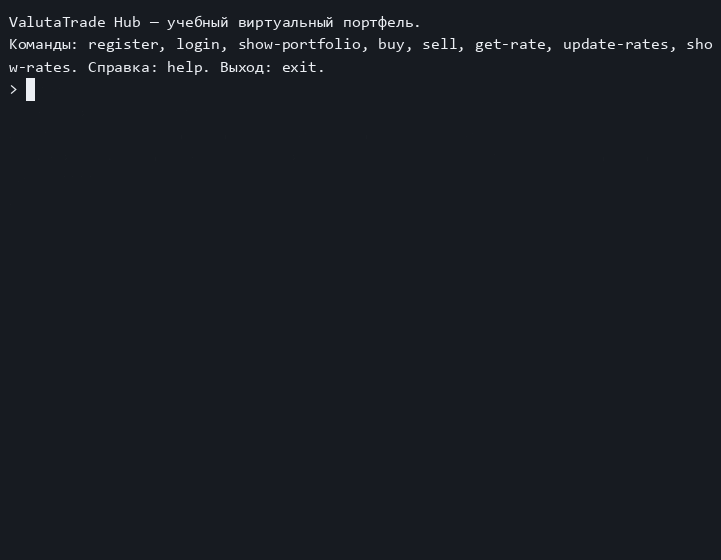

# Итоговый проект — ValutaTrade Hub

> СГЕНЕРИРОВАНО ИИ!(При моём активном участии :D)

Дисциплина: «Программирование на Python», группа М26-555. Консольное приложение для виртуального портфеля фиатных и криптовалют. Реальных покупок, переводов и подключения к биржевым кошелькам здесь нет.

## Демонстрация

Регистрация, вход, обновление реальных курсов, покупка и продажа, портфель, фильтры и обработка ошибок:



GIF получен из настоящей локальной терминальной записи. Пользователь и пароль в ней учебные, курсы получены из API на момент записи. Ключи сервисов не показываются. Исходная запись не загружалась на общедоступные сервисы.

## Текущее состояние

Реализованы Core Service, Parser Service и все восемь команд CLI. Авторская локальная проверка завершена 25 октября 2026 года, проект принят автором. Пакет не опубликован в PyPI, работа не отправлена в LMS.

По согласованию с автором выбрана пошаговая модель CLI из задания: `buy` увеличивает баланс выбранной валюты, `sell` уменьшает его, USD используется для оценки. Произвольного стартового баланса и автоматического списания/зачисления на USD-кошелёк нет.

## Запуск

Нужны [uv](https://docs.astral.sh/uv/getting-started/installation/) и Python 3.12. Для локальной работы закреплён Python 3.12.10; `uv` может подготовить нужный интерпретатор. Примеры ниже — для PowerShell, запускать из корня проекта:

```powershell
uv sync --locked
if (-not (Test-Path -LiteralPath .env)) { Copy-Item -LiteralPath .env.example -Destination .env }
```

Заполните фиатный ключ в `.env`, как описано ниже, и запустите приложение:

```powershell
uv run --locked --env-file .env valutatrade
```

`uv` создаёт `.venv` и устанавливает зависимости из `uv.lock`. Команда `valutatrade` открывает интерактивную сессию. `help` показывает команды, `help get-rate` — справку по отдельной команде, `exit`, EOF или Ctrl+C завершают приложение. Также работает `uv run --locked --env-file .env python main.py`.

Вход действует в текущем запущенном процессе. После перезапуска нужно снова выполнить `login`; пользователи и балансы при этом сохраняются. Для работы с теми же данными используйте тот же рабочий каталог.

## Сервисы и ключи

Для курсов используются ExchangeRate-API и CoinGecko. Отдельная биржа, платный тариф, сервер базы данных и Docker для начала работы не нужны.

Если `.env` уже существует, не перезаписывайте его. Для первого запуска скопируйте пустой шаблон командой из раздела установки и заполните значение после знака `=`:

```dotenv
EXCHANGERATE_API_KEY=
```

`EXCHANGERATE_API_KEY` — ключ вашего аккаунта ExchangeRate-API. CoinGecko работает только в публичном режиме без ключа, как разрешено заданием и выбрано автором. Продолжать регистрацию, получать Demo-ключ или покупать Pro-тариф не нужно.

Файл `.env` исключён из Git и сборки. В Git хранится только пустой `.env.example`. Не отправляйте ключи в чат, README, скриншоты и логи.

Для загрузки настроек из `.env`:

```powershell
uv run --env-file .env valutatrade --check-config
```

Проверка выводит только наличие ключей. Она не отправляет запросы и не подтверждает действительность ключа. При запуске установленного пакета без `uv` переменные окружения нужно передать отдельно.

Для ExchangeRate-API используется Standard endpoint с полем `conversion_rates`. Он возвращает курсы из базовой валюты в остальные; при сохранении, например, `EUR_USD` значение инвертируется. Бесплатный ключевой тариф даёт 1500 запросов в месяц и обновляет исходные фиатные котировки раз в день.

CoinGecko запрашивается одним пакетом по ID `bitcoin`, `ethereum`, `solana`, а не по тикерам. В проекте отслеживаются USD, EUR, GBP, RUB, BTC, ETH и SOL. При недоступности API или ограничении запросов приложение сообщает об ошибке; успешный ответ другого источника сохраняется отдельно.

## Команды и пример сессии

Внутри запущенного приложения:

```text
register --username alice --password demo-password
login --username alice --password demo-password
update-rates
show-rates --top 2
buy --currency BTC --amount 0.05
buy --currency EUR --amount 200
sell --currency BTC --amount 0.01
show-portfolio
show-portfolio --base EUR
get-rate --from USD --to BTC
show-rates --currency RUB
show-rates --currency BTC --base EUR
exit
```

`demo-password` здесь — пример, не пароль от внешнего сервиса. Не используйте личные пароли в учебной демонстрации.

- `register --username ... --password ...` создаёт уникального пользователя и пустой портфель. Имя не может быть пустым, пароль — короче четырёх символов. Регистрация не выполняет автоматический вход.
- `login --username ... --password ...` проверяет соль и SHA-256 хеш. Пароль в открытом виде в JSON не сохраняется; SHA-256 выбран по учебному ТЗ, а не как рекомендация для промышленной авторизации.
- `show-portfolio [--base USD]` показывает балансы и общую стоимость через PrettyTable. Требуется вход.
- `buy --currency BTC --amount 0.05` добавляет 0.05 единицы BTC, не покупку на 0.05 USD. Отсутствующий кошелёк создаётся автоматически.
- `sell --currency BTC --amount 0.01` списывает 0.01 BTC только при достаточном остатке. `buy` и `sell` требуют входа и положительной конечной числовой суммы.
- `get-rate --from USD --to BTC` показывает прямой и обратный курсы. Поддерживается пересчёт через общую валюту, в том числе USD.
- `update-rates [--source coingecko|exchangerate]` обновляет оба источника либо только указанный. При частичном отказе выводятся сохранённое количество курсов и ошибки; процесс завершается с ненулевым кодом, если команда запущена отдельно.
- `show-rates [--currency BTC] [--top 2] [--base EUR]` читает локальный кэш, фильтрует валюты, выбирает самые дорогие криптовалюты или пересчитывает базу. Сам по себе этот просмотр не делает сетевых запросов.

Строковые аргументы с пробелами заключайте в кавычки. Пример: `register --username "Алиса Тест" --password "demo password"`.

Независимые команды можно запускать без интерактивной сессии:

```powershell
uv run --locked --env-file .env valutatrade update-rates --source coingecko
uv run --locked --env-file .env valutatrade show-rates --top 2
```

Для последовательности `login` → `buy`/`sell` используйте одну интерактивную сессию: каждый отдельный запуск начинает новую сессию входа.

## Кэш, история и логи

`data/rates.json` содержит объект `pairs` с последними курсами и общую метку `last_refresh`. У каждой пары есть `rate`, `updated_at`, `source` и безопасные метаданные. Новый срез заменяет прежний только при более свежем `updated_at`.

TTL кэша — 300 секунд, параметр `rates_ttl_seconds` в `[tool.valutatrade]` файла `pyproject.toml`. `get-rate`, оценка портфеля и торговые операции используют только подходящие по TTL записи. Если нужного курса нет или он просрочен, выполняется попытка обновления. При неудаче старое значение не выдаётся за свежее. `show-rates` может показать старые записи, но помечает их как `УСТАРЕЛ` и предлагает `update-rates`.

`updated_at` — время успешного получения данных приложением в UTC. Время самой котировки провайдера хранится отдельно в `meta.source_updated_at` и показывается в `get-rate`. Поэтому повторная загрузка дневного фиатного курса не означает появления новой котировки. Время из API не заменяется вымышленным «свежим» временем.

`data/exchange_rates.json` — история измерений с идентификаторами вида `BTC_USD_<ISO-UTC timestamp>`. Повтор одного идентификатора не дублирует историю. Записи проходят валидацию, сохраняются через временные файлы и `replace`; операции с общими JSON-файлами защищены также межпроцессной блокировкой. Коды валют и даты приводятся к единому формату.

Логи: `logs/actions.log` и `logs/parser.log`, формат JSON Lines, уровень INFO. У операций записываются время, действие, пользователь, валюта, сумма, курс, база, результат и ошибка; для покупки/продажи — также баланс до и после. Декоратор `log_action` не проглатывает исключения. Ротация по размеру: 1 000 000 байт и три резервных файла; параметры находятся в настройках.

Планировщик `parser_service.scheduler.run_periodically` доступен для явного вызова, но при импорте или запуске CLI автоматически не включается. По умолчанию используется ручное обновление; частоту автоматического опроса следует выбирать с учётом квоты провайдера.

## Структура

```text
finalproject_bocharov_m26-555/
├── valutatrade_hub/
│   ├── core/
│   │   ├── models.py          # User, Wallet, Portfolio
│   │   ├── currencies.py      # Currency, FiatCurrency, CryptoCurrency
│   │   ├── exceptions.py
│   │   ├── usecases.py
│   │   └── utils.py
│   ├── infra/
│   │   ├── settings.py        # Singleton SettingsLoader
│   │   └── database.py        # Singleton DatabaseManager
│   ├── parser_service/
│   │   ├── config.py
│   │   ├── api_clients.py
│   │   ├── updater.py
│   │   ├── storage.py
│   │   └── scheduler.py
│   ├── cli/interface.py
│   ├── logging_config.py
│   └── decorators.py
├── data/                     # создаётся локально, не входит в Git
│   ├── users.json
│   ├── portfolios.json
│   ├── rates.json
│   └── exchange_rates.json
├── assets/demo.gif
├── main.py
├── .env.example
├── pyproject.toml
└── uv.lock
```

Пакет расположен в корне, как в ТЗ; в пакетных директориях есть `__init__.py`. Модели и usecases не печатают интерфейс и не читают ввод. HTTP-клиенты находятся в Parser Service, файловые операции — в инфраструктуре и хранилище.

Локальные `.env`, `data/`, `logs/`, `.venv`, настройки редактора, записи терминала и служебные проверки не попадают в репозиторий. При отсутствии JSON-файлов приложение работает с пустым хранилищем и создаёт их по мере использования. Учётные данные в примерах и GIF — синтетические, не пароли от внешних сервисов.

## Проверка и сборка

```powershell
uv run --locked ruff check .
uv run --locked ruff format --check .
uv build
uvx twine check dist/valutatrade_hub-0.1.0.tar.gz dist/valutatrade_hub-0.1.0-py3-none-any.whl
```

Установка wheel в отдельное окружение для проверки без editable-режима:

```powershell
uv venv .package-check --python 3.12.10
uv pip install --python .package-check/Scripts/python.exe dist/valutatrade_hub-0.1.0-py3-none-any.whl
.package-check/Scripts/valutatrade.exe --help
```

Локальные автоматические проверки и отчёт соответствия рубрике хранятся отдельно от репозитория. Они не являются официальными тестами Практикума; результат внешней проверки и оценка преподавателя пока не получены. В PyPI пакет не публиковался.

## Источники

- [Официальное задание](https://practicum.yandex.ru/learn/higher-data-analytics/courses/1bcb1235-88f7-4049-872c-ccf2eadab374/sprints/1080939/topics/a4396349-49d2-482a-a148-1946895c0688/lessons/34db6c2a-235e-48a9-861a-daacbb724e72/) — структура и требования проекта.
- [Критерии оценки](https://practicum.yandex.ru/learn/higher-data-analytics/courses/1bcb1235-88f7-4049-872c-ccf2eadab374/sprints/1080939/topics/a4396349-49d2-482a-a148-1946895c0688/lessons/5950826f-0236-430e-8809-7ca77d849019/) — рубрика на 50 баллов.
- [ExchangeRate-API: Standard Requests](https://www.exchangerate-api.com/docs/standard-requests) — контракт фиатных курсов.
- [CoinGecko: формат ответов /simple/price](https://docs.coingecko.com/reference/simple-price) — цены и время обновления; в проекте используется публичный домен `api.coingecko.com` без ключа, не платный Pro.
- [Бесплатные планы ExchangeRate-API](https://www.exchangerate-api.com/docs/free) — ограничения частоты обновления и запросов.

Источники проверены 25 октября 2026 года. Максимум по рубрике — 50 баллов; подтверждённый дедлайн и результат проверки пока не зафиксированы.
